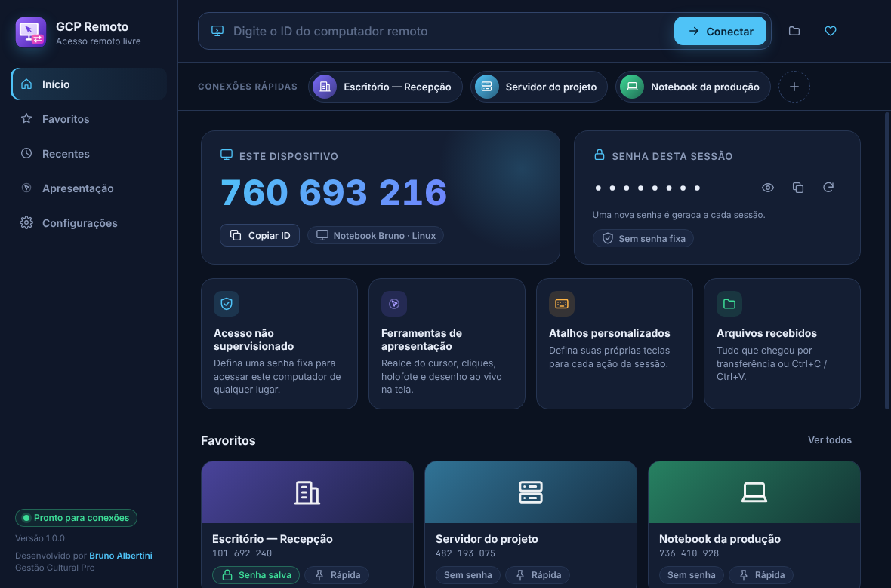
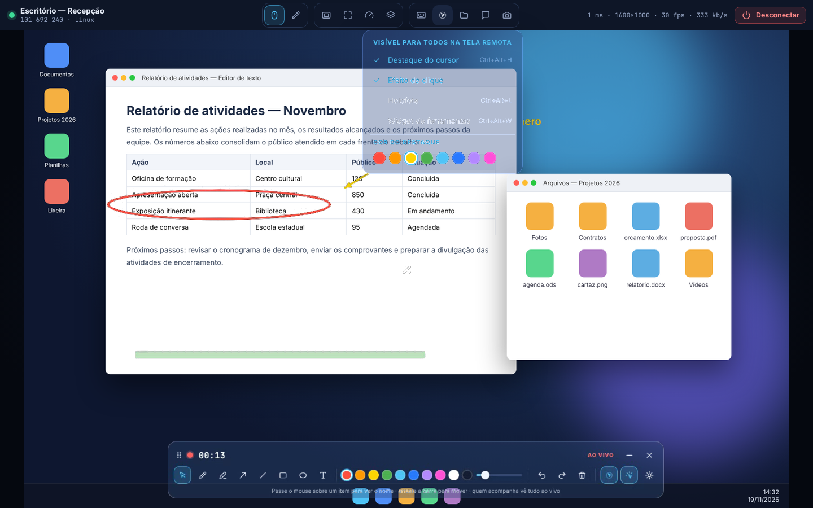
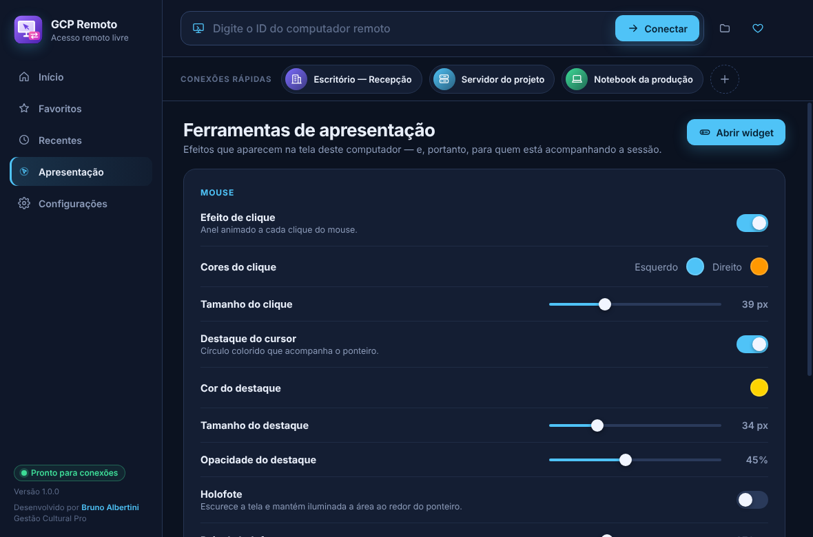
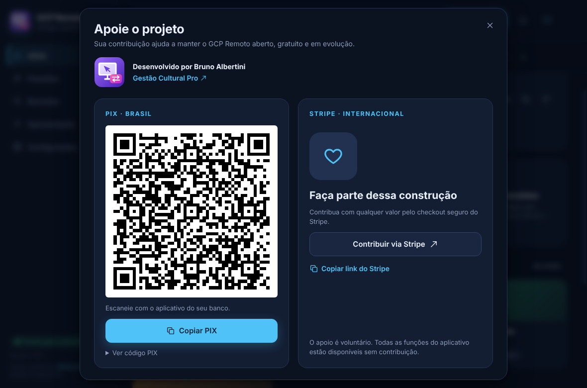

# GCP-Remoto

## Novidades 1.2.0

- **Ctrl+C no computador remoto, Ctrl+V aqui:** copie arquivos de qualquer jeito no outro computador (teclado, botão direito, Explorer, Dolphin, área de trabalho) e cole com Ctrl+V em qualquer pasta, com janela de progresso sempre visível.
- **Colar na Área de Trabalho** com um clique ao final da cópia, em qualquer sistema.
- **Ctrl+0** limpa todos os desenhos.

Na versão 1.1.0: desempenho quase em tempo real, ponteiro preciso, teste de conexão e atualizações pelo GitHub. Na 1.0.2: instalação em dois cliques e AppImage que se instala sozinho. Na 1.0.1: reinício automático após atualizar, widget em janela própria e atalhos simples. Na 1.0.0: acesso remoto entre Windows e Linux nos dois sentidos, desenho ao vivo, arquivos com Ctrl+C / Ctrl+V e pacote para Arch, BigLinux e Manjaro. Veja o [histórico de versões](HISTORICO.md).

**Acesso remoto gratuito, livre e completo, com interface em português.**

O GCP-Remoto reúne num só programa o que se espera de uma ferramenta profissional de suporte e acesso remoto: controle total do mouse e do teclado, senha nova a cada sessão, acesso não supervisionado, favoritos com nome personalizado, transferência de arquivos, chat e ferramentas de apresentação para explicar e ensinar na tela da outra pessoa. Sem cadastro, sem anúncios e sem limite de tempo. Tudo vem dentro do próprio instalador.

Desenvolvido por **Bruno Albertini | [Gestão Cultural Pro](https://gestaoculturalpro.com.br/)**.



## Telas

Capturas do aplicativo em tema escuro.

| | |
|---|---|
| <br>**Sessão** — controle total e desenho ao vivo na tela remota | <br>**Pedido de acesso** — aceitar ou recusar, escolhendo as permissões |
| <br>**Arquivos** — os dois computadores lado a lado, Ctrl+C / Ctrl+V | <br>**Exibição** — ajustar, tamanho original, esticar, tamanhos de janela e tela cheia |
| <br>**Apresentação** — widget expandido e efeitos visíveis para todos | <br>**Favoritos** — nome personalizado, ícone, cor e senha salva |
| <br>**Efeitos do mouse** — clique, destaque do cursor e holofote | <br>**Atalhos** — todas as ações da sessão com teclas personalizadas |
| <br>**Apoie o projeto** — PIX e Stripe, sempre voluntário | <br>**Avisos** — sessão iniciada e desconectada, com duração |

## Baixar

Baixe a versão mais recente na página de [versões publicadas](https://github.com/cliqueprojeto/GCP-Remoto/releases/latest). Todas as opções instalam com dois cliques, sem terminal:

| Sistema | Arquivo | Como instalar |
|---|---|---|
| **Windows 10 e 11** | `GCP-Remoto-Instalador-x.y.z-x64.exe` | Dois cliques: instala e já abre, com atalhos na área de trabalho e no menu Iniciar. |
| **Windows (sem instalar)** | `GCP-Remoto-Portatil-x.y.z-x64.exe` | Dois cliques e usa. Ideal para pendrive: os dados ficam ao lado do executável. |
| **Qualquer Linux** (BigLinux, Ubuntu, Fedora…) | `GCP-Remoto-x.y.z-linux-x86_64.AppImage` | Dois cliques (se o sistema perguntar, confirme **Executar**). Ele se instala sozinho no menu de aplicativos, em **Internet**. Abrir uma versão mais nova atualiza a instalada. |
| **BigLinux, Arch, Manjaro** | `gcp-remoto-x.y.z-1-x86_64.pkg.tar.zst` | Dois cliques abrem o **Pamac** (ou botão direito › Abrir com › Instalar pacotes locais) e clique em **Aplicar**. |
| **Ubuntu, Debian, Mint, Zorin** | `GCP-Remoto-x.y.z-linux-amd64.deb` | Dois cliques abrem a loja de aplicativos; clique em **Instalar**. |
| **Fedora, openSUSE** | `GCP-Remoto-x.y.z-linux-x86_64.rpm` | Dois cliques abrem o GNOME Software ou o Discover; clique em **Instalar**. |
| **Windows (pasta compactada)** | `GCP-Remoto-x.y.z-win-x64.zip` | Descompacte e abra `GCP Remoto.exe`. |

Como o instalador ainda não tem assinatura digital de código, o Windows pode mostrar "O Windows protegeu o computador". Clique em **Mais informações** e depois em **Executar assim mesmo**.

**Atualizar:** instale a versão nova por cima, do mesmo jeito. Se o GCP-Remoto estiver aberto na bandeja, ele reinicia sozinho na versão nova quando não houver sessão em andamento.

**Linux com Wayland (BigLinux com KDE Plasma 6, GNOME):** o GCP-Remoto usa o portal do próprio sistema para compartilhar a tela e controlar mouse e teclado. Na primeira sessão, o sistema mostra uma janela pedindo permissão; escolha a tela e confirme. A permissão é lembrada nas próximas vezes. Se as janelas do app não aparecerem ou não responderem, ative **Configurações › Geral › Modo de compatibilidade X11** e reabra o programa.

O AppImage requer FUSE 2, já presente na maioria das distribuições.

## Como usar

1. Instale o GCP-Remoto nos dois computadores.
2. No computador que será acessado, a tela inicial mostra o **ID** (nove dígitos) e a **senha desta sessão**.
3. No outro computador, digite o ID e clique em **Conectar**. Informe a senha, ou clique em **Pedir para aceitar** para que a pessoa libere o acesso pela janela de aceite.
4. Marque **Salvar nos favoritos** e dê um nome ao computador: da próxima vez, é só um clique nas **Conexões rápidas**.

## O que ele faz

### Conectar com segurança
- ID fixo de nove dígitos para cada computador e **senha nova gerada a cada sessão**.
- **Senha fixa opcional** para acesso não supervisionado, quando não há ninguém na frente do computador.
- **Janela de aceite destacada** no computador acessado, sempre por cima das outras janelas: mostra quem está pedindo e o sistema usado, permite escolher as permissões (controle, arquivos, área de transferência e desenho) e recusa sozinha se ninguém responder.
- Avisos estilizados de **sessão iniciada** e **sessão desconectada**, com o nome de quem estava conectado e a duração.
- Faixa de **sessão ativa** na janela principal, com controle e arquivos liberados ou bloqueados a qualquer momento, chat e botão para encerrar.
- A senha nunca trafega pela rede: a verificação usa um desafio SHA-256. Após várias tentativas erradas, novas tentativas ficam bloqueadas por alguns minutos.
- Imagem, controle e arquivos vão **direto de um computador para o outro**, com criptografia WebRTC (DTLS/SRTP).

### Favoritos e conexões rápidas
- Computadores salvos com **nome personalizado**, ícone (computador, notebook, servidor, casa, escritório, pessoa) e cor.
- Senha salva de forma cifrada no chaveiro do sistema, para conectar sem digitar.
- **Barra de Conexões rápidas** no topo da janela e no menu da bandeja do sistema.
- Histórico de sessões recentes, com o sistema operacional e há quanto tempo foi a conexão.

### Controlar o computador remoto
- Mouse completo (botões esquerdo, direito e do meio, rolagem, arrastar) e teclado completo, **com acentos, ç e símbolos em qualquer layout** (ABNT2, US e outros).
- Envio de combinações de teclas: Ctrl+Alt+Del, Ctrl+Shift+Esc, Alt+Tab, Alt+F4, tecla Windows/Super, Print Screen e outras.
- **Vários monitores**, com troca rápida entre eles.
- Modo **somente visualização**.
- Área de transferência de texto sincronizada nos dois sentidos e **chat** integrado.
- Captura de tela da sessão, salva em Imagens › GCP Remoto.

### Desempenho
- Transmissão em tempo real por WebRTC, com exibição imediata de cada quadro (sem buffer de espera).
- Codificação de vídeo pela placa de vídeo (H.264) quando disponível; senão VP8, o mais leve no processador.
- Perfis: **Velocidade** (fluidez em primeiro lugar, como TeamViewer), **Equilibrado** e **Qualidade de imagem**.
- Movimentos do mouse por um canal próprio, sem fila de reenvio, até 120 vezes por segundo.
- **Teste de conexão** (Configurações › Conexão): mede o servidor, o tipo de rede e a aceleração de vídeo e aplica as configurações recomendadas.

### Atualizações
- Em **Configurações › Geral › Atualizações**: verificar sempre que abrir, todos os dias, por semana, a cada duas semanas, por mês ou nunca, além de **Verificar agora**.
- A instalação se adapta ao sistema: no Windows, o instalador roda em silêncio e reabre o programa; no AppImage, a cópia instalada é substituída; nos pacotes do Linux, o instalador do sistema (Pamac, Discover) é aberto. Cada arquivo é conferido pela assinatura SHA-256 publicada na versão.

### Exibição
- Ajustar à janela, **tamanho original (1:1)** com rolagem, ou esticar.
- Tamanhos de janela prontos (1024×640 até 1920×1080), igual à resolução remota, maximizar e **tela cheia** com barra que se esconde.
- Resolução transmitida (até 4K), 15, 30 ou 60 quadros por segundo e quatro níveis de qualidade, ajustáveis durante a sessão.
- Latência, resolução, quadros por segundo e taxa de transmissão exibidos em tempo real.

### Desenhar e apresentar na tela remota
- Caneta, marca-texto, seta, linha, retângulo, elipse e **texto**, com 10 cores, espessura, desfazer, refazer e limpar.
- **Destaque do cursor**, **anéis de clique** (cores diferentes para o botão esquerdo e o direito) e **holofote**, que escurece a tela e ilumina a área ao redor do ponteiro.
- **Widget flutuante** recolhido (cronômetro e caneta) ou expandido com todas as ferramentas, que pode ser arrastado para qualquer lugar da tela.
- Tudo é desenhado na tela do computador acessado: quem está do outro lado vê exatamente o mesmo, ao vivo.
- As ferramentas de apresentação também funcionam sem sessão, para aulas e reuniões.

### Transferir arquivos
- **Ctrl+C neste computador e Ctrl+V na tela remota**, e o contrário, para arquivos e pastas inteiras.
- Arquivos copiados no computador remoto (Ctrl+C, botão direito › Copiar, em qualquer gerenciador ou na área de trabalho) chegam prontos para colar aqui; até 1 GB a cópia começa na hora, acima disso o programa pergunta.
- Janela de progresso sempre por cima, com porcentagem, velocidade, tempo restante e Cancelar; ao terminar, **Colar na Área de Trabalho** ou **Abrir pasta**.
- Gerenciador com os dois computadores lado a lado: navegar, enviar e baixar.
- Arrastar e soltar arquivos sobre a tela remota.
- Arquivos recebidos ficam em Downloads › GCP Remoto (a pasta pode ser escolhida nas Configurações).

### Atalhos personalizados
Todas as ações da sessão têm atalho configurável em **Configurações › Atalhos**: tela cheia, modo desenho, desfazer, limpar, somente visualização, capturar tela, próximo monitor, chat, arquivos, modos de exibição, Ctrl+Alt+Del, widget, destaque do cursor, holofote e desconectar.

### Aparência
- Interface escura com destaque ciano, ícones próprios e janelas de aviso estilizadas.
- Ícone na bandeja do sistema que muda quando há uma sessão ativa.
- Iniciar com o sistema, iniciar minimizado e continuar disponível com a janela fechada.

## Privacidade

O GCP-Remoto não exige conta e não guarda suas sessões em servidores. Por padrão, os computadores se encontram pelo servidor público gratuito do PeerJS, que apenas apresenta um computador ao outro pelo ID. A imagem da tela, o controle e os arquivos trafegam diretamente entre os dois computadores, com criptografia. Configurações, favoritos e senhas salvas ficam apenas no seu computador.

Para independência total, hospede o seu próprio servidor de conexão (pasta [`server/`](server/)) e configure o endereço em **Configurações › Conexão**. O `docker-compose.yml` inclui também um servidor TURN (coturn) para redes muito restritas, como internet móvel com CGNAT e redes corporativas.

```bash
cd server && docker compose up -d
```

## Apoie o projeto

O GCP-Remoto é gratuito e continuará gratuito. Se ele for útil para você, considere apoiar o desenvolvimento pelo coração (♥) no topo da janela do aplicativo, onde há um QR Code PIX e o link do Stripe, ou diretamente:

- **Stripe (internacional):** [donate.stripe.com/fZu4gzeBSfhbd7451F6Ri00](https://donate.stripe.com/fZu4gzeBSfhbd7451F6Ri00)
- **PIX (Brasil):** use o QR Code ou o botão **Copiar PIX** dentro do aplicativo.

O apoio é voluntário. Todas as funções do aplicativo estão disponíveis sem contribuição.

## Para desenvolvedores

O GCP-Remoto é feito com Electron, WebRTC (PeerJS para sinalização), libnut para mouse e teclado no Windows e no Linux X11, protocolo X11/XTEST em JavaScript para digitação precisa com acentos, e o portal RemoteDesktop via D-Bus no Wayland.

Requisitos de desenvolvimento: Node.js 22 e npm.

```bash
npm ci               # instala as dependências travadas
npm start            # abre o programa
npm test             # roda os testes automatizados
npm run dist:linux   # gera .deb, .rpm, .pkg.tar.zst e AppImage em dist/
npm run dist:win     # gera o instalador, a versão portátil e o zip (no Windows)
```

O workflow **Compilar e publicar** compila no Ubuntu e no Windows a cada envio ao `main`, executa os testes e publica os instaladores na versão indicada em `package.json`.

Estrutura:

- `src/main/` — processo principal: janelas, senhas, injeção de mouse e teclado, arquivos, notificações e camada de desenho.
- `src/renderer/` — interface: janela principal, sessão, camada sobre a tela, notificações e apoio.
- `server/` — servidor de sinalização opcional e TURN.

Sugestões e problemas podem ser enviados na aba [Issues](https://github.com/cliqueprojeto/GCP-Remoto/issues).

## Licença

**Software livre — GPL-3.0-or-later.**

**Autoria:** Bruno Albertini | Gestão Cultural Pro.

O GCP-Remoto é software livre: você pode redistribuí-lo e modificá-lo sob os termos da **GNU General Public License, versão 3 ou posterior**, publicada pela Free Software Foundation. Ele é distribuído na esperança de ser útil, mas **sem nenhuma garantia**. Veja o arquivo [LICENSE](LICENSE).

Os componentes de terceiros mantêm suas próprias licenças, listadas em [THIRD_PARTY_NOTICES.md](THIRD_PARTY_NOTICES.md).
